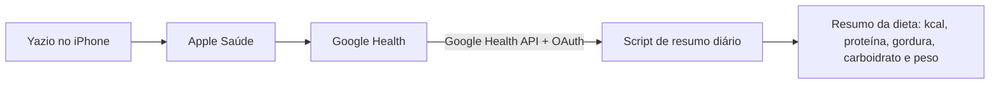

# Google Health + Yazio: site para publicar seu app OAuth de graça

Site estático, hospedado de graça no **GitHub Pages**, com as duas páginas que o Google exige para tirar um app OAuth do modo de teste:

- [Página inicial](https://vmartellacci.github.io/) (`index.html`)
- [Política de privacidade](https://vmartellacci.github.io/privacy.html) (`privacy.html`)

Ele existe para um projeto pessoal: ler automaticamente os registros de alimentação e peso que o **Yazio** sincroniza com o **Google Health**, pela [Google Health API](https://developers.google.com/health/get-started), e gerar um resumo diário da dieta.

## Por que isso é necessário

Quando você cria um app OAuth no Google Cloud para uso próprio, ele começa em **modo de teste**. Nesse modo o Google derruba a autorização **a cada 7 dias**, e você precisa autorizar tudo de novo.

Para publicar o app (status "Em produção"), o Google pede:

1. uma página inicial,
2. uma política de privacidade,
3. ambas em um **domínio autorizado** que seja seu.

Um repositório `seu-usuario.github.io` resolve os três sem gastar nada: o GitHub publica o site sozinho em `https://seu-usuario.github.io`.

> Para uso pessoal (só a sua conta autorizando), o Google não exige a verificação formal do app. Na tela de consentimento vai aparecer o aviso "app não verificado"; basta clicar em **Avançado** e depois em **Continuar**.

## Como reutilizar no seu projeto (passo a passo)

### 1. Crie o site

1. Faça um **fork** deste repositório (ou crie um repositório novo e copie os dois arquivos `.html`).
2. Renomeie o repositório para **`seu-usuario.github.io`** (troque `seu-usuario` pelo seu login do GitHub). Ele precisa ser **público**.
3. Edite `index.html` e `privacy.html`: troque o nome do app, o seu nome e o e-mail de contato.
4. Espere 1 ou 2 minutos e abra `https://seu-usuario.github.io/privacy.html` para confirmar que está no ar.

### 2. Configure o app no Google Cloud

No [Google Auth Platform](https://console.cloud.google.com/auth/branding), no seu projeto:

1. **Branding**
   - Página inicial do aplicativo: `https://seu-usuario.github.io/`
   - Link da Política de Privacidade: `https://seu-usuario.github.io/privacy.html`
   - Domínios autorizados: `seu-usuario.github.io`
2. **Público-alvo**, depois clique em **Publicar app** e confirme.
3. Autorize o app mais uma vez. O novo acesso deixa de vencer em 7 dias.

## Como a integração funciona (visão geral)

- **Fonte dos dados:** o Yazio (versão PRO) sincroniza refeições e peso com o Google Health.
- **Acesso:** um cliente OAuth do tipo "App para computador" no Google Cloud, com a Google Health API ativada.
- **Escopos usados:** `googlehealth.nutrition.readonly`, `googlehealth.nutrition.writeonly`, `googlehealth.activity_and_fitness.readonly` e `googlehealth.health_metrics_and_measurements.readonly`.
- **Leitura:** `GET https://health.googleapis.com/v4/users/me/dataTypes/nutrition-log/dataPoints` (refeições) e `.../weight/dataPoints` (peso).

## Segurança

- Este repositório contém **apenas páginas públicas**. Nunca coloque aqui o arquivo `client_secret*.json`, tokens ou dados de saúde.
- Você pode revogar o acesso do app a qualquer momento em [myaccount.google.com/permissions](https://myaccount.google.com/permissions).

## Aviso

Projeto pessoal, sem vínculo com Google, Yazio ou Apple. Os resumos gerados são informativos e não substituem orientação de nutricionista ou médico.

## Licença

Uso livre (MIT). Copie, adapte e use no seu projeto.
